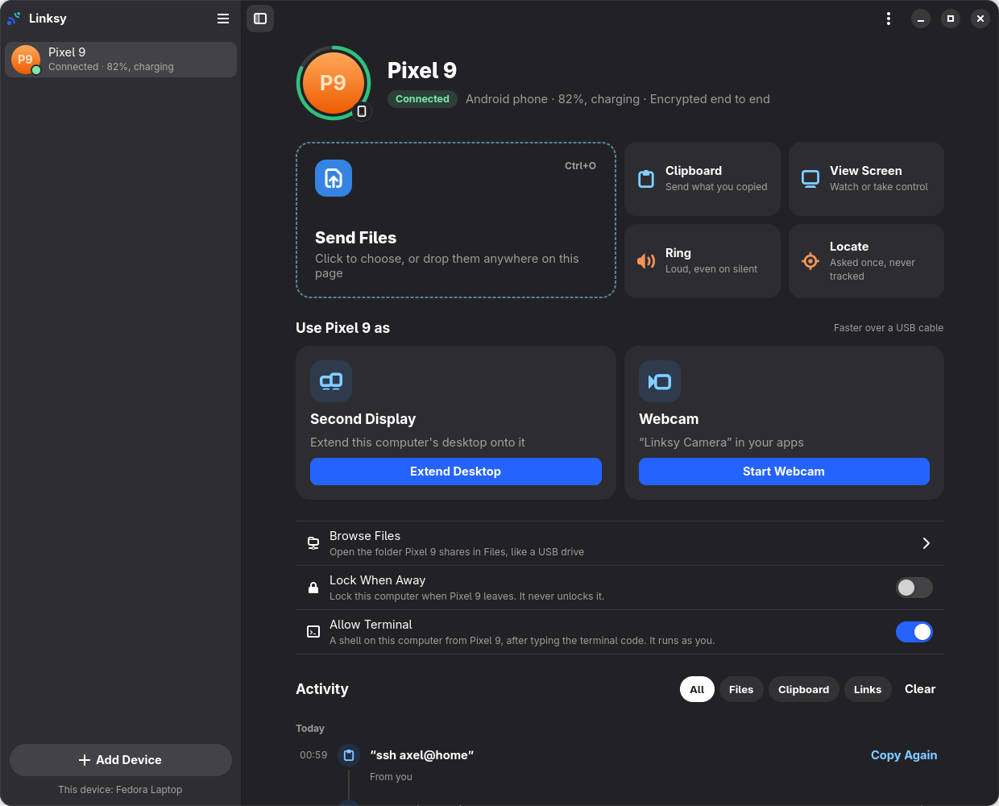
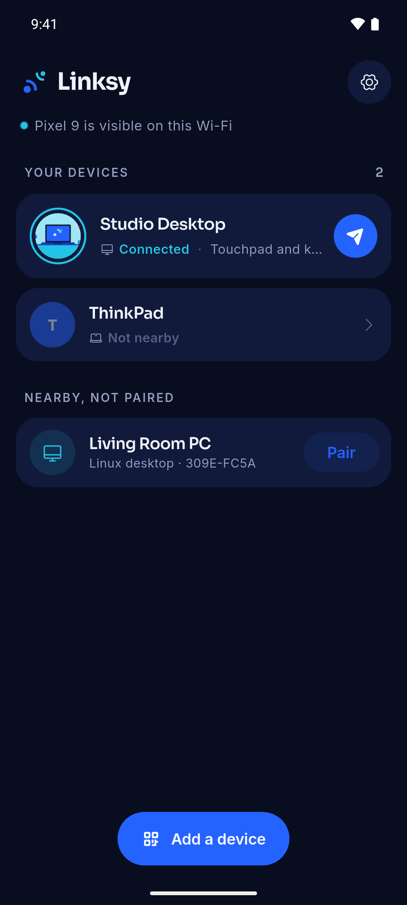
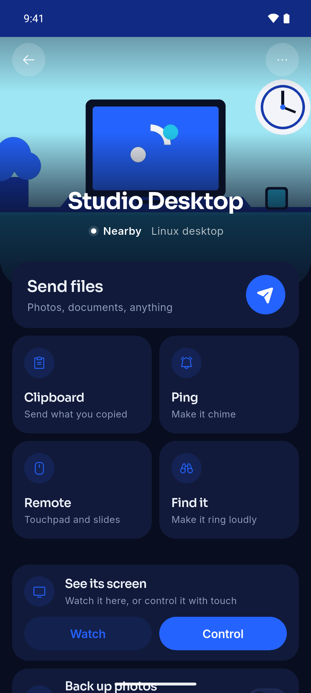
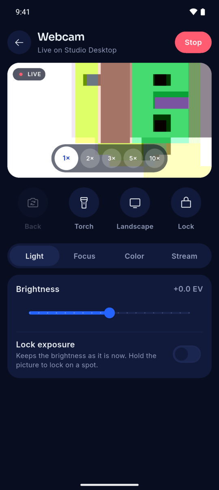
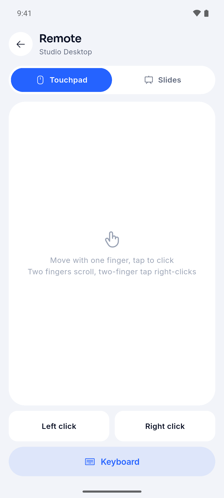
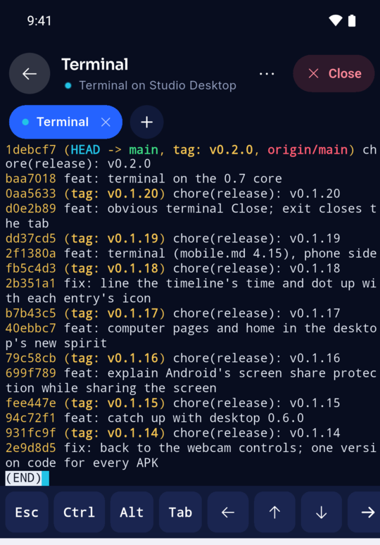
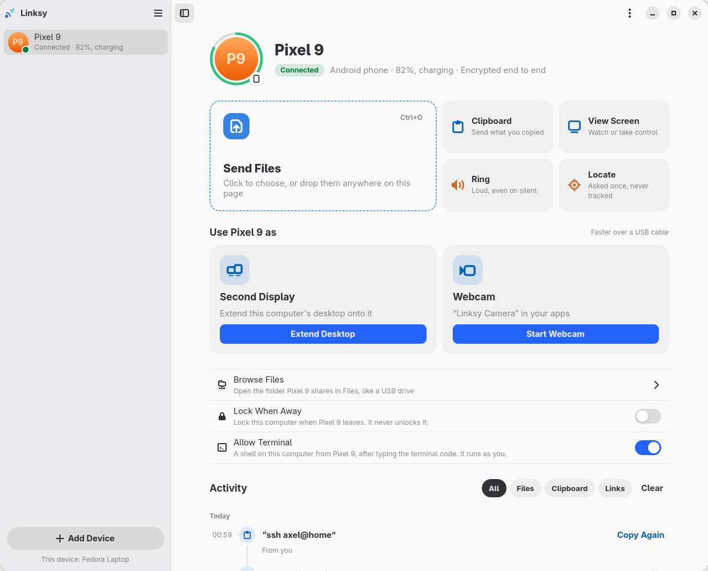
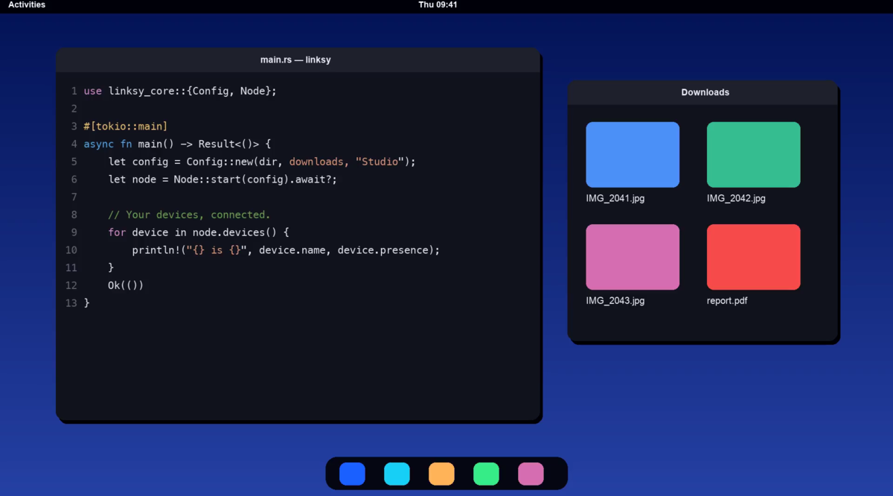

<p align="center">
  
</p>

<h1 align="center">Linksy</h1>

<p align="center">
  <b>Your Android phone and your Linux computer, working as one.</b><br>
  Files, clipboard, screens, a webcam and more, straight between your own devices.<br>
  No account. No cloud. Free and open source.
</p>

<p align="center">
  <a href="#android"><b>Android</b></a> ·
  <a href="#linux"><b>Linux</b></a> ·
  <a href="https://linksy.diary.mg">Website</a> ·
  <a href="https://github.com/LinkSy-mg/linksy-releases/issues">Report a problem</a>
</p>

<p align="center">
  
</p>

## Install

Install Linksy on both devices, open it on each, and pair them once: both screens show the
same code. Two Linux computers pair the same way.

### Android

| | |
|---|---|
| **[Linksy for every phone](https://linksy.diary.mg/download/android)** | Start here. |
| [64-bit phones](https://linksy.diary.mg/download/android-arm64) | Smaller download. |
| [32-bit phones](https://linksy.diary.mg/download/android-armv7) | Smaller, for older phones. |

Always the newest version. Open the file on the phone, allow installing from your browser
once, and install. To update, install a newer one the same way.

### Linux

<!-- linux:start -->
Linksy **0.9.6** for x86_64. Two packages: `linksy-common` (runs in the background) and the
app for your desktop: `linksy` for GNOME and most desktops, `linksy-qt` for KDE Plasma.

**The quickest way, any distribution**

```sh
# Finds your system and desktop, asks which app (GNOME or KDE Plasma), installs it with one password
curl -fsSL https://linksy.diary.mg/install.sh | sh
```

[See what it does](https://linksy.diary.mg/install.sh). Older systems get the Flatpak. Or do it by hand:

**Fedora · GNOME and others**

```sh
# The background service, and the GTK app
curl -LO https://linksy.diary.mg/download/linksy-common-0.9.6-1.x86_64.rpm
curl -LO https://linksy.diary.mg/download/linksy-0.9.6-1.x86_64.rpm
# Install both together
sudo dnf install ./linksy-common-0.9.6-1.x86_64.rpm ./linksy-0.9.6-1.x86_64.rpm
```

**Fedora · KDE Plasma**

```sh
# The background service, and the Qt 6 app
curl -LO https://linksy.diary.mg/download/linksy-common-0.9.6-1.x86_64.rpm
curl -LO https://linksy.diary.mg/download/linksy-qt-0.9.6-1.x86_64.rpm
# Install both together
sudo dnf install ./linksy-common-0.9.6-1.x86_64.rpm ./linksy-qt-0.9.6-1.x86_64.rpm
```

> **On KDE Plasma, for the systems below too:** replace `linksy` with `linksy-qt` in the app's
> file name, for example `linksy_0.9.6_amd64.deb` becomes `linksy-qt_0.9.6_amd64.deb`, in both
> the download and the install line. `linksy-common` stays the same. The Plasma app needs
> Ubuntu 25.04 or newer.

**Ubuntu 24.04+, Linux Mint 22+, Debian 13+** (the KDE app: Ubuntu 25.04+, Debian 13+)

```sh
# The background service, and the GTK app
curl -LO https://linksy.diary.mg/download/linksy-common_0.9.6_amd64.deb
curl -LO https://linksy.diary.mg/download/linksy_0.9.6_amd64.deb
# Install both together
sudo apt install ./linksy-common_0.9.6_amd64.deb ./linksy_0.9.6_amd64.deb
```

> **Older systems** (Debian 12, Ubuntu 22.04, Linux Mint 21 and older): use
> the **Flatpak** below. It brings everything it needs (the GTK app). Install Flatpak first:
> `sudo apt install flatpak`.

**openSUSE Tumbleweed**

```sh
# The background service, and the GTK app
curl -LO https://linksy.diary.mg/download/linksy-common-0.9.6-1.suse.x86_64.rpm
curl -LO https://linksy.diary.mg/download/linksy-0.9.6-1.suse.x86_64.rpm
# Install both together (not signed yet, hence the flag)
sudo zypper install --allow-unsigned-rpm ./linksy-common-0.9.6-1.suse.x86_64.rpm ./linksy-0.9.6-1.suse.x86_64.rpm
```

**Any distribution: Flatpak**

```sh
# Everything in one file (the GTK app), installed for your user
curl -LO https://linksy.diary.mg/download/linksy-0.9.6.flatpak
flatpak install --user linksy-0.9.6.flatpak
```

**Any distribution, no root: tarball**

```sh
# The GTK app, into your home folder; uninstall.sh removes it
curl -LO https://linksy.diary.mg/download/linksy-0.9.6-linux-x86_64.tar.gz
tar xzf linksy-0.9.6-linux-x86_64.tar.gz && linksy-0.9.6-linux-x86_64/install.sh
```

Notes and checksums: [Linux 0.9.6](https://github.com/LinkSy-mg/linksy-releases/releases/tag/linux-v0.9.6).
<!-- linux:end -->

Then open **Linksy** from your apps. **Finish Setup** adds anything a feature still needs
(a codec, the webcam driver, the firewall rule), with one password.

- **Needs:** GTK app: glibc 2.39+, GTK 4.14+, libadwaita 1.6+. Plasma app: Qt 6.8+, KDE
  Frameworks 6.13+.
- **Flatpak:** the webcam in every app and the USB cable need one command, which Finish
  Setup gives you; the phone's terminal stays inside the sandbox.
- **Older versions:** on the [releases page](https://github.com/LinkSy-mg/linksy-releases/releases),
  as **Android** and **Linux** releases.

## What it does

- **Files**: any size, both ways; drop them on the window. Resumed and checked byte for byte.
- **Clipboard**: copy on one, paste on the other. Text, a screenshot or a small file.
- **Open on PC**: share a link from any phone app, it opens on the computer.
- **Webcam and microphone**: the phone's, in every app on the computer.
- **Second display**: a tablet, phone or another computer extends your desktop.
- **Screens**: see and control another device's screen.
- **Remote**: the phone as a touchpad, keyboard or slide clicker.
- **Find your phone**: ring it, even on silent, or ask where it is.
- **Lock when away**: walk off with your phone, the computer locks.
- **Terminal**: your computer's shell on the phone, behind a code you set.
- **Away from home**: files, clipboard, links and Ring over the internet, for a week after
  your devices last met.
- **Wi-Fi or USB cable**: whichever is there.

## Screenshots

<p align="center">
  
  
  
  
  
</p>

<p align="center">
  
  
</p>

## Private by design

- **Paired once**: devices compare a code, then only talk to each other.
- **Encrypted end to end**: QUIC and TLS 1.3, with each device's own key.
- **Nothing collected**: no account, no sign-in, no analytics.
- **The relay can't read**: away from home it only helps your devices find each other.
- **Always asks**: screens, cameras, microphones and the terminal ask first and show while on.

## Windows, macOS, iPhone?

No plans. Linksy aims to be the best at Linux and Android: each other system would be a
whole new app, its best features (webcam, second display) need paid, signed drivers, and an
iPhone app can barely run in the background or read the clipboard.

## Help

- **Something wrong?** [Open an issue](https://github.com/LinkSy-mg/linksy-releases/issues)
  with what you did and what happened.
- **First pairing:** both devices on the same network, or a USB cable. Finish Setup checks
  the firewall lets them meet.

Free and open source under the GNU AGPL v3.0 or later:
[LinkSy-mg/linksy-desktop](https://github.com/LinkSy-mg/linksy-desktop). A star there helps
others find Linksy.
