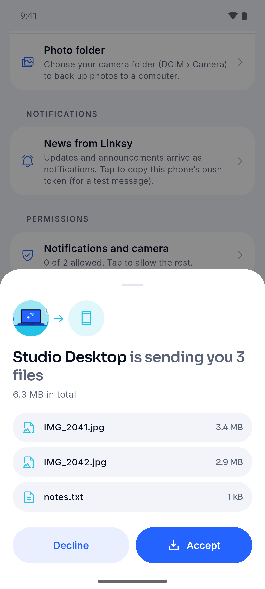
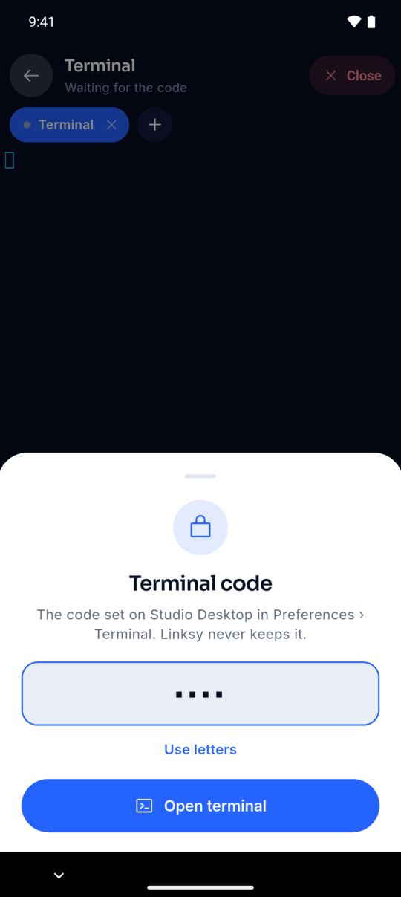

  

<h1 align="center">Linksy</h1>

  <b>Your phone and your computer, connected. Or two computers.</b> 
  Files, clipboard, screens, a webcam and more, straight between your own devices. 
  No account. No cloud. Nothing stored anywhere but on your devices.

  <a href="#android"><b>Android</b></a> ·
  <a href="#linux"><b>Linux</b></a> ·
  <a href="https://linksy.diary.mg">Website</a> ·
  <a href="https://github.com/LinkSy-mg/linksy-releases/issues">Report a problem</a>

  

## Download

Install Linksy on both devices, open it on each, and pair them once: both screens show
the same code. That's it.

It works between any two devices with Linksy, not only a phone and a computer: two Linux
computers on the same network pair the same way, then send files and the clipboard, see
and control each other's screen, or use one as a second display for the other.

### Android

| | |
|---|---|
| **[Linksy for every phone](https://linksy.diary.mg/download/android)** | Works on every Android phone. Start here. |
| [Linksy for 64-bit phones](https://linksy.diary.mg/download/android-arm64) | Smaller, for 64-bit phones. |
| [Linksy for 32-bit phones](https://linksy.diary.mg/download/android-armv7) | Smaller, for older 32-bit phones. |

These always give the newest version, saved as `linksy-<version>.apk` (`-arm64` or
`-armv7` for the smaller ones), so you can tell which one you have. Older versions are on
the [releases page](https://github.com/LinkSy-mg/linksy-releases/releases): **Mobile
release** is the Android app, **Desktop release** the Linux app.

Open the downloaded file on the phone. Android asks once to allow installing apps from
your browser; allow it, then install. To update, install a newer one the same way.

### Linux

<!-- linux:start -->
Linksy **0.8.3** for x86_64. Pick the one for your system:

| System | Download | Then, in a terminal |
|---|---|---|
| **Fedora** 41+ | [linksy-0.8.3-1.x86_64.rpm](https://github.com/LinkSy-mg/linksy-releases/releases/download/linux-v0.8.3/linksy-0.8.3-1.x86_64.rpm) | `sudo dnf install ./linksy-0.8.3-1.x86_64.rpm` |
| **Ubuntu** 24.10+, **Debian** 13+ | [linksy_0.8.3_amd64.deb](https://github.com/LinkSy-mg/linksy-releases/releases/download/linux-v0.8.3/linksy_0.8.3_amd64.deb) | `sudo apt install ./linksy_0.8.3_amd64.deb` |
| **Any distribution** (Flatpak) | [linksy-0.8.3.flatpak](https://github.com/LinkSy-mg/linksy-releases/releases/download/linux-v0.8.3/linksy-0.8.3.flatpak) | `flatpak install --user linksy-0.8.3.flatpak` |
| Any distribution, no root | [linksy-0.8.3-linux-x86_64.tar.gz](https://github.com/LinkSy-mg/linksy-releases/releases/download/linux-v0.8.3/linksy-0.8.3-linux-x86_64.tar.gz) | `tar xzf linksy-0.8.3-linux-x86_64.tar.gz && linksy-0.8.3-linux-x86_64/install.sh` |

Release notes and checksums: [Linksy 0.8.3 for Linux](https://github.com/LinkSy-mg/linksy-releases/releases/tag/linux-v0.8.3).
<!-- linux:end -->

Then open **Linksy** from your apps. If your system is missing something a feature needs
(a codec, the camera driver, the firewall rule), **Finish Setup** opens and adds it all in
one go; your computer asks for your password once. Linksy updates itself in the
background after you install a newer version, and tells you when there is one.

The .deb, .rpm and tarball need glibc 2.39+, GTK 4.14+ and libadwaita 1.6+ (the systems
above have them). The Flatpak runs anywhere, but can't add the webcam driver or open a
terminal for your phone.

### Windows, macOS, iPhone?

No, and there are no plans for them. Linksy is for Linux computers and Android phones,
and aims to be the best at exactly that. Why not the others:

- **Each one is a whole new app.** Linksy looks and behaves like it came with your
  desktop; on Windows and macOS that means writing and maintaining it again, from scratch,
  for each.
- **Their best features need drivers.** Your phone as a webcam, a microphone or a second
  display means system drivers on Windows and macOS, which those systems only accept
  after paid signing and approval, and which break with their updates.
- **The gatekeeping costs time and money.** Apple and Microsoft want yearly developer
  fees, signing and notarization before an app installs without warnings. And iPhone
  apps can barely run in the background or read the clipboard on their own, so most of
  what Linksy does couldn't work there.

That time goes into making Linksy better on Linux and Android instead.

## What it does

Between a phone and a computer, or between two computers:

- **Files and folders**, any size, both ways. Drop them on the window; transfers resume
  and are checked byte for byte.
- **Clipboard**: copy on one, paste on the other. Text, a screenshot or a small file.
- **Open on PC**: share a link from any phone app and it opens on the computer.
- **Your phone as a webcam, microphone or second display**, in every app.
- **See and control** another device's screen, or use the phone as a touchpad, keyboard
  or slide clicker.
- **Find your phone**: make it ring, even on silent, or ask where it is.
- **Lock when away**: walk off with your phone and the computer locks.
- **Terminal on your phone**: Claude Code, neovim or a build on your computer, behind a
  code you set on the computer.
- **Away from home**: files, clipboard, links and Ring over the internet too, for a week
  after your devices were last together.
- Over **Wi-Fi** or a **USB cable**.

## Screenshots

On the phone: your computers, a computer's page, files arriving, the phone as a touchpad.

  
  
  
  

**Your computer's terminal on the phone.** Only after the code you set on the computer;
then a real shell, with Esc, Ctrl, Alt, Tab and arrows above the keyboard.

  
  

**The phone as the computer's webcam, and the computer's screen on the phone.**

  
  

On the computer, light or dark:

  

## Private by design

- Devices pair once by comparing a code; after that they only talk to each other,
  encrypted end to end (QUIC, TLS 1.3 with each device's own key).
- No account, no sign-in, no analytics. Nothing about you or your files is sent anywhere.
- Away from home, Linksy's relay only helps two devices find each other; it can't read
  anything.
- Screens, cameras, microphones and the terminal always ask first, and show while
  they're on.

## Help

- Something not working? [Open an issue](https://github.com/LinkSy-mg/linksy-releases/issues)
  with what you did and what happened.
- Both devices need to be on the same network the first time you pair them (or connected
  by a USB cable). On Linux, Finish Setup checks your firewall lets them meet.

Linksy is freeware: free to use on all your devices, for personal or commercial use, and
free to share unmodified. [License](https://linksy.diary.mg/license).
